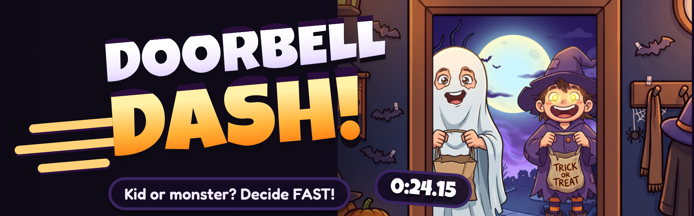
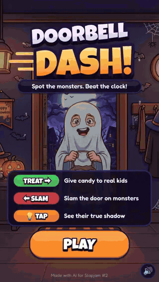

<p align="center">
  
</p>

<h1 align="center">🎃 Doorbell Dash 🔔</h1>

<p align="center">
  <b>Kid or monster? Decide FAST!</b><br>
  A Halloween speedrun at your front door — made in 48 hours for <a href="https://itch.io/jam/slapjam-ai-2">Slapjam #2</a> (theme: <b>SPEED</b>).
</p>

<p align="center">
  <a href="https://franciscotomasjimenezanton26.github.io/GAME/"><b>▶ PLAY IN YOUR BROWSER</b></a>
  &nbsp;·&nbsp;
  <a href="https://fjimenez22.itch.io/doorbell-dash">itch.io page</a>
  &nbsp;·&nbsp;
  <a href="https://itch.io/jam/slapjam-ai-2/rate/5237777">Jam entry</a>
</p>

<p align="center">
  
</p>

---

## How to play

It's Halloween night and the doorbell won't stop ringing. Some of those "costumes" aren't costumes at all. Serve **15 visitors** as fast as you can:

| Action | Touch | Keyboard |
|---|---|---|
| 🍬 Give candy to a real kid | Swipe **right** | → |
| 🚪 Slam the door on a monster | Swipe **left** | ← |
| 💡 Turn on the porch light to see their true shadow | **Tap** | Space |

Look for the clue: a tail, glowing eyes, floating feet, claws, fangs, horns, a tentacle, fur…

- ⏱️ Your final **time is your score**.
- ❌ Every mistake adds **+3 seconds**.
- 🍭 Chain correct calls for a **SUGAR RUSH**: visitors come faster and the music speeds up.
- 🏆 Ranks from **D · Haunted House** to **S · King of Halloween**, with live splits against your best time.

📱 Best played on a phone in portrait. It works on desktop too.

## Run it locally

No build step and no dependencies to install: it's plain JavaScript with [Phaser 3](https://phaser.io) (included in `lib/`).

1. Clone or download this repository.
2. Serve the folder with any static server, for example:
   - **VS Code** → *Live Server* extension → right-click `index.html` → *Open with Live Server*
   - or `npx serve .` / `python3 -m http.server`
3. Open the address it shows. To play on your phone, use your computer's local IP on the same Wi-Fi (e.g. `http://192.168.1.20:5500`).

> Opening `index.html` directly as a file won't work: browsers block loading images and sounds from `file://`.

Useful URL options: `?debug` (or the **D** key) shows a debug panel, `?canvas` forces the Canvas renderer.

## Project structure

```
index.html            entry page (fonts, rotate-your-phone overlay, scripts)
src/
  config.js           all tunable values: rules, timings, ranks, colors, fonts
  data/visitors.js    the 8 characters and the clue that gives each monster away
  assets.js           list of images, sounds and music to load
  records.js          best time and splits (localStorage)
  audio.js            sound effects, music, mute, mobile audio unlock
  fx.js               game feel: shake, flash, punch, particles, hit stop
  swipe.js            swipe and tap detection
  ui.js               gradient titles, pill buttons, timer, backdrop
  visitor.js          a visitor at the door, its art and its shadow
  scenes/             Boot · Menu · Play · Results · Debug
  main.js             Phaser setup
assets/               img · sfx · music · fonts
lib/phaser.min.js     Phaser 3.88.2
tools/                browser tools used to process AI art and audio, and to build the itch.io zip
itch/                 itch.io page art: cover, banner, screenshots, GIF, description
docs/                 planning notes written during the jam (in Spanish)
```

To build the zip for itch.io: `tools/empaquetar.bat` (Windows) or `bash tools/empaquetar.sh` → `build/juego-itch.zip`.

## Credits

Made by **FJ** ([FJimenez22 on itch.io](https://fjimenez22.itch.io)).

**AI tools used**
- **Claude (Anthropic)**: game design, all the code, sound design and the production tools
- **Google Gemini (Nano Banana)**: the 16 characters, the porch, the hallway and the door
- **Google Gemini (Lyria)**: music

**Other assets**
- Sound effects based on [Kenney](https://www.kenney.nl)'s *Interface Sounds*, *RPG Audio* and *Impact Sounds* (CC0)
- Fonts: [Luckiest Guy](https://fonts.google.com/specimen/Luckiest+Guy) (Apache 2.0) and [Fredoka](https://fonts.google.com/specimen/Fredoka) (SIL OFL 1.1)
- Engine: [Phaser 3](https://phaser.io) (MIT)

## License

The **code** is released under the [MIT License](LICENSE). Images and music are © FJ and are not covered by the MIT License. Sounds, fonts and Phaser keep their own licenses (see the license files in `assets/` and `lib/`).

---

<details>
<summary>🇪🇸 En español</summary>

**Doorbell Dash** es un juego de Halloween hecho en 48 horas para la Slapjam #2 (tema: velocidad). Desliza a la derecha para dar caramelos a los niños y a la izquierda para dar un portazo a los monstruos. Toca para encender la luz y ver su sombra de verdad. Atiende a 15 visitantes lo más rápido que puedas: cada error suma 3 segundos.

**Jugar:** https://franciscotomasjimenezanton26.github.io/GAME/

**Probarlo en tu ordenador:** abre la carpeta en VS Code con la extensión Live Server (clic derecho en `index.html` → *Open with Live Server*).

En `docs/` están las notas del proceso: el plan, las reglas de la jam, los prompts usados para el arte y la guía de la página de itch.io.

</details>
